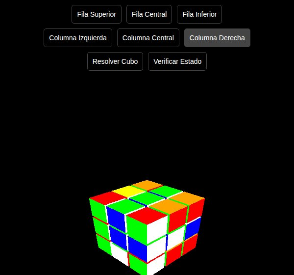

# Cubo de Rubik 3D Interactivo (Web)

Este proyecto es una simulación interactiva en 3D de un cubo de Rubik, desarrollada con **HTML**, **CSS** y **JavaScript** usando la biblioteca **Three.js**. Permite rotar filas y columnas, verificar si el cubo está resuelto, y restaurarlo a su estado inicial.

### 🧠 ¿Qué puedes hacer?

- Rotar filas (superior, central, inferior).
- Rotar columnas (izquierda, central, derecha).
- Verificar si el cubo está en su posición original.
- Restablecer el cubo al estado resuelto.

### 💡 Tecnologías utilizadas

- HTML5
- CSS3
- JavaScript (ES6)
- Three.js (motor gráfico 3D)
- OrbitControls (para controlar la cámara)

### 🚀 ¿Cómo usarlo?

1. Abre el archivo `index.html` en tu navegador.
2. Usa los botones para rotar partes del cubo.
3. Haz clic en "Verificar Estado" para comprobar si está resuelto.
4. Haz clic en "Resolver Cubo" para reiniciarlo.

> No requiere instalación ni dependencias externas. Funciona directamente en el navegador.

### 👨‍💻 Autor

Dominic de Freitas

---

¡Gracias por visitar este repositorio!

