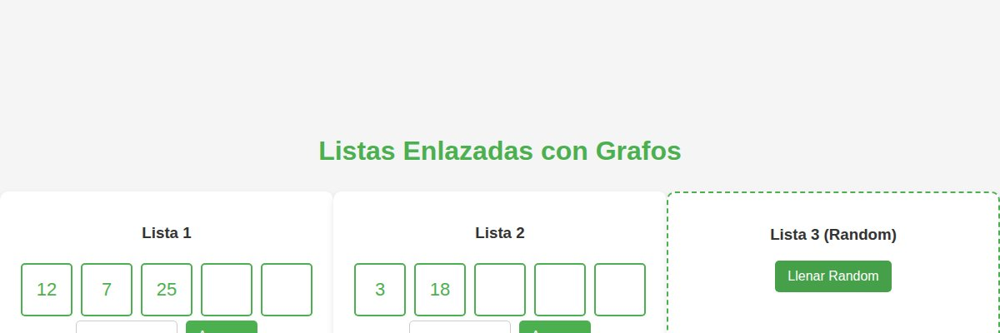

# 🔗 Estructuras de datos — Listas enlazadas

Implementaciones propias de **listas enlazadas** (nodos y apuntadores) en dos formatos:

| Archivo | Qué hace |
|---|---|
| `lista_enlazada_consola.py` | Clases `Nodo` y `ListaEnlazada` propias: inserción, recorrido y combinación de dos listas en una tercera, con datos aleatorios. |
| `listas-enlazadas-visual.html` | Visualización web de listas enlazadas como grafo, con apuntadores dibujados. |

```bash
python lista_enlazada_consola.py
```

**Autor:** Dominic De Freitas


<p align="center"></p>
