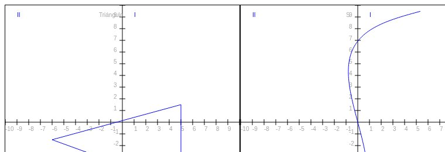

# 🌐 Proyectos PHP y web

| Carpeta | Qué hace | Tecnologías |
|---|---|---|
| `probador-componentes/` | Prueba la **cámara, el micrófono** (con visualizador de audio) y la pantalla táctil del equipo desde el navegador. | PHP, JavaScript (MediaDevices, Web Audio API, Canvas) |
| `extractor-ip-dns/` | Recibe una URL, obtiene su **IP y registros DNS** y guarda el historial en MySQL con consultas preparadas. | PHP, MySQL |
| `corrector-ortografico-php/` | Corrector ortográfico en español con diccionario propio, consultado vía `fetch`. | PHP, JavaScript |
| `calculadora-php/` | Calculadora de suma organizada en vista, lógica y funciones (`include`), con validación del formulario. | PHP |
| `graficos-canvas/` | Gráficos dibujados a mano con la API **Canvas** de HTML5. | HTML, JavaScript |

<p align="center"></p>

## Cómo ejecutarlos
```bash
cd probador-componentes
php -S localhost:8000
```
Para `extractor-ip-dns`: crea la base con `schema.sql` y define `DB_USER` / `DB_PASSWORD` como variables de entorno.

**Autor:** Dominic De Freitas
